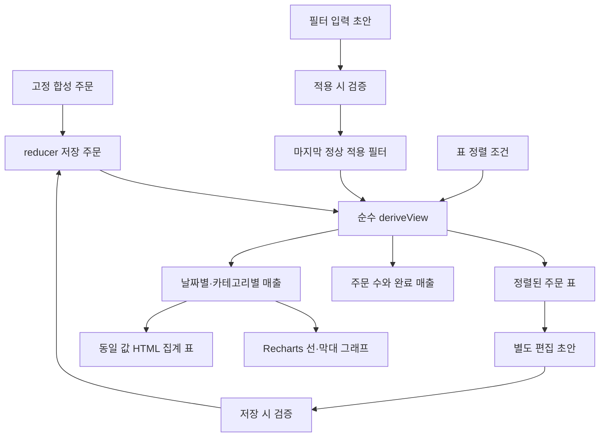

# 데이터 운영 데모 설계

합성 주문의 검색·편집·요약·시각화를 연결하는 개인 프론트엔드 데모다. 실제 고객 데이터나 업무 성과를 뜻하지 않는다. [요구사항](REQUIREMENTS.md)과 [테스트 설계](TEST-DESIGN.md)를 함께 제공한다. 테스트 실행 결과는 설계와 별도로 확인한다.

## 화면과 상태의 수명

공개 경로는 /{locale}/lab/data-operations-demo다. 데모·요구사항·설계·테스트 설계 네 탭 중 최초 탭은 데모다. 공개 문구 원본은 content/data-operations-messages.ts이며 영어·일본어·한국어를 제공한다. 정적 문서는 서버에서 구성하고 운영 화면은 별도 Client Component로 둔다. API Rescue Lab은 독립적으로 유지한다.

패널을 마운트한 채 비선택 패널을 숨겨 문서 왕복 시 주문·필터·편집 초안을 유지한다. 좌우 화살표·Home·End와 roving tabindex로 조작한다. 새로고침과 언어 이동은 모든 메모리 상태를 새로 만들고 데모 탭으로 돌아간다. 탭 URL·브라우저 기록·영구 저장은 추가하지 않는다.

## 데이터와 계산 경로

Order는 유일한 ID, 달력 날짜 YYYY-MM-DD, 상품명, 고정 카테고리, 정수 엔 금액, pending | completed | cancelled 상태를 가진다. 고정 샘플은 타입이 지정된 상수다. 날짜 입력은 실제 존재하는 달력 날짜인지 검사하며 시간대로 변환하지 않는다. 편집 금액은 문자열로 유지하고 저장 경계에서 0~1,000,000엔의 정수인지 검증한다. 빈 값·음수·소수·문자·상한 초과는 저장하지 않는다.

로컬 reducer가 저장 주문, 필터 초안, 마지막 정상 적용 필터, 정렬, 편집과 안내를 소유한다. 한 화면이므로 전역 저장소를 추가하지 않는다. 필터를 타이핑하는 것만으로 적용하거나 편집을 폐기하지 않는다. 적용 버튼은 열린 편집을 닫고 초안을 폐기한다. 잘못된 날짜를 적용하면 오류와 마지막 정상 결과를 유지한다. 기본 정렬은 날짜 오름차순이다.

순수 deriveView는 저장 주문을 적용 필터로 한 번 걸러 행·요약·두 계열을 도출한다. 검색은 ID·상품명 부분 일치이며 공백·영문 대소문자를 무시한다. 필터는 AND, 날짜는 양 끝 포함이다. 정렬은 표에만 적용하며 동률은 ID 순이다. 완료 주문만 매출에 포함한다. 날짜 계열은 샘플 범위와 적용 기간의 교집합에서 빠진 날짜를 0으로 채운다. 카테고리 계열도 허용 카테고리를 0 포함해 표시한다. 집계를 별도 상태로 복제하지 않고 미저장 편집은 계산에서 제외한다.

## Recharts 선택과 대안

Recharts의 선언적 React 컴포넌트로 선·막대, 축, 툴팁과 레이아웃을 구성한다. 같은 집계 배열을 전달하면 React 상태 변경에 맞춰 갱신된다. 차트 개발 도구는 포함하지 않는다.

| 대안 | 판단 |
| --- | --- |
| Recharts | React 컴포넌트로 구성하고 축·툴팁·배치를 라이브러리에 맡길 수 있어 선택 |
| Chart.js | canvas 기반의 유효한 대안이나 현재 화면에서는 canvas 연결 또는 React 래퍼를 추가할 이유가 적음 |
| SVG 직접 구현 | 축·툴팁·배치를 직접 관리해야 하므로 사용하지 않음 |

Recharts 내부 출력은 SVG다. SVG 출력을 금지한 것이 아니라 직접 그리는 작업을 라이브러리에 맡기는 선택이다. 동일한 계열을 의미 있는 HTML 집계 표에도 전달해 정확한 값이 색·호버에 의존하지 않게 한다. 0 기준선과 엔 단위를 유지하며 결과 0건·완료 0건·완료 금액 0엔을 구분한다.

## 편집·초기화·접근성

매출·주문 수·완료 수를 필터보다 먼저 표시하며 매출 카드를 강조한다. 적용 조건과 조회 건수를 결과 위에 요약하고, 필터 초안이 적용값과 다르면 미적용 안내를 표시한다. 안내는 기존 초안·적용값의 비교에서 도출하며 새 상태를 중복 저장하지 않는다. 잘못된 날짜를 적용해도 요약은 마지막 정상 조건을 유지한다.

명시적 행 버튼으로 선택 주문 바로 다음 표 행에 편집 폼을 연다. 선택 행을 강조하고 상태는 글자와 색 배지로 구분한다. 금액은 오른쪽 정렬과 동일 너비 숫자를 사용한다. 금액·상태 외 필드는 읽기 전용이다. 잘못된 저장은 원본을 유지하고 입력에 오류를 연결한다. 취소는 초안만 폐기한다. 저장 성공은 한 주문을 갱신하고 상세를 닫는다. 현재 필터에서 빠진 행은 제거하고 이유를 안내한다. 포커스는 열었던 버튼 또는 행이 사라졌으면 결과 제목으로 복귀한다.

가로 스크롤이 필요한 표에서도 편집 폼은 스크롤 컨테이너 너비를 기준으로 제한한다. 전체 표 너비로 펼치는 대안은 모바일에서 입력이 화면 밖으로 밀리므로 사용하지 않는다. 그래프는 같은 높이와 제목·단위 배치를 사용하고 격자는 옅게 표시한다. 카테고리 그래프는 가로 막대로 표시해 좁은 화면에서 긴 카테고리 이름의 겹침을 피한다. 툴팁은 날짜 또는 카테고리와 정확한 엔 금액을 제공한다.

필터 초기화는 저장한 수정을 유지한다. 샘플 초기화는 저장 주문·필터·정렬·편집을 원본으로 되돌린다. 새로고침과 언어 이동도 원본으로 복원한다. 입력 label, 표 caption·열 제목·aria-sort, 상태 안내와 보이는 포커스를 제공한다. 좁은 화면은 세로 배치하고 가로 스크롤은 표 영역으로 제한한다. 이는 검증할 기준이며 브라우저·모바일 확인 완료 선언이 아니다.

## 검증과 후속 경계

순수 도메인 함수는 lib/data-operations.test.ts, reducer 전이와 조작은 components/data-operations-demo.test.tsx, 탭은 components/project-documents.test.tsx에서 검증한다. 타입 검사·빌드는 실제 브라우저의 차트 배치·키보드·모바일 확인을 대체하지 않는다.

백엔드·Supabase·인증·외부 쓰기·localStorage·영구 저장은 없다. Supabase는 사용자 식별·행 소유권·권한·초기화·실패·충돌 처리 후 검토할 후속 후보다. CSV, 주문 추가·삭제, 결제, 실시간 갱신과 다중 통화도 제외한다. 공개·배포는 별도 작업이다.
